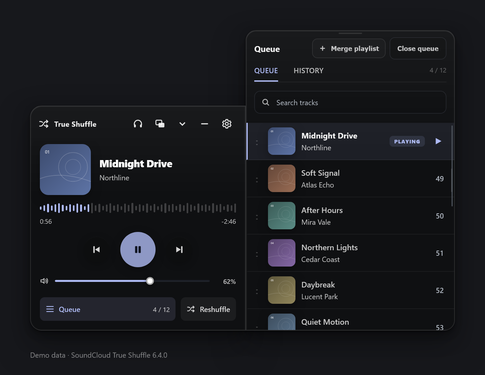
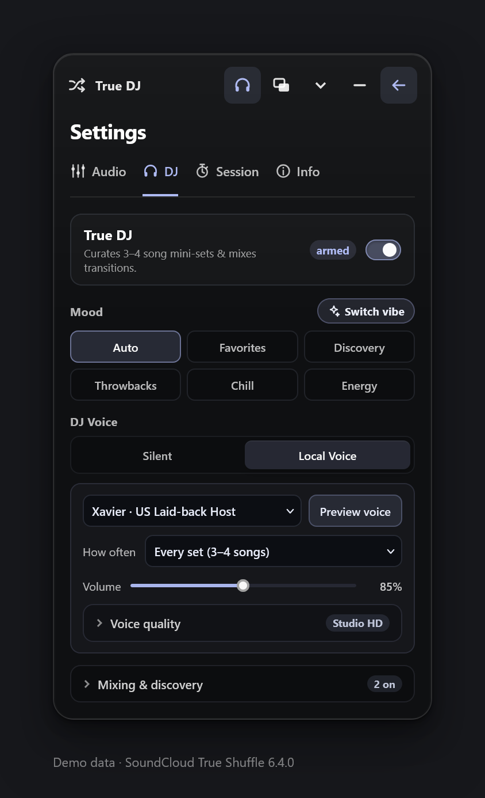
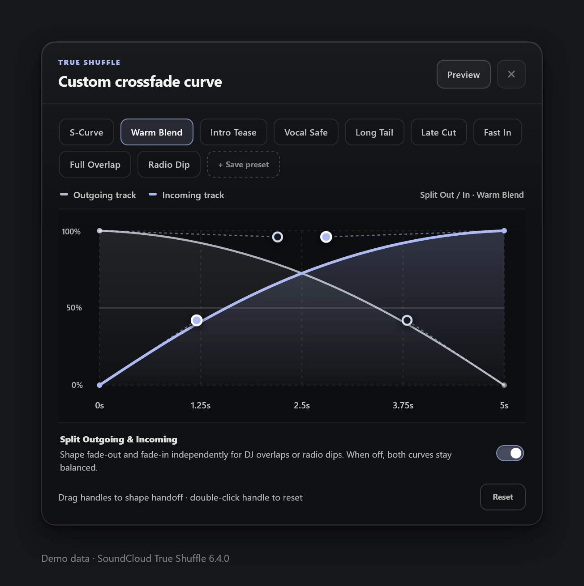
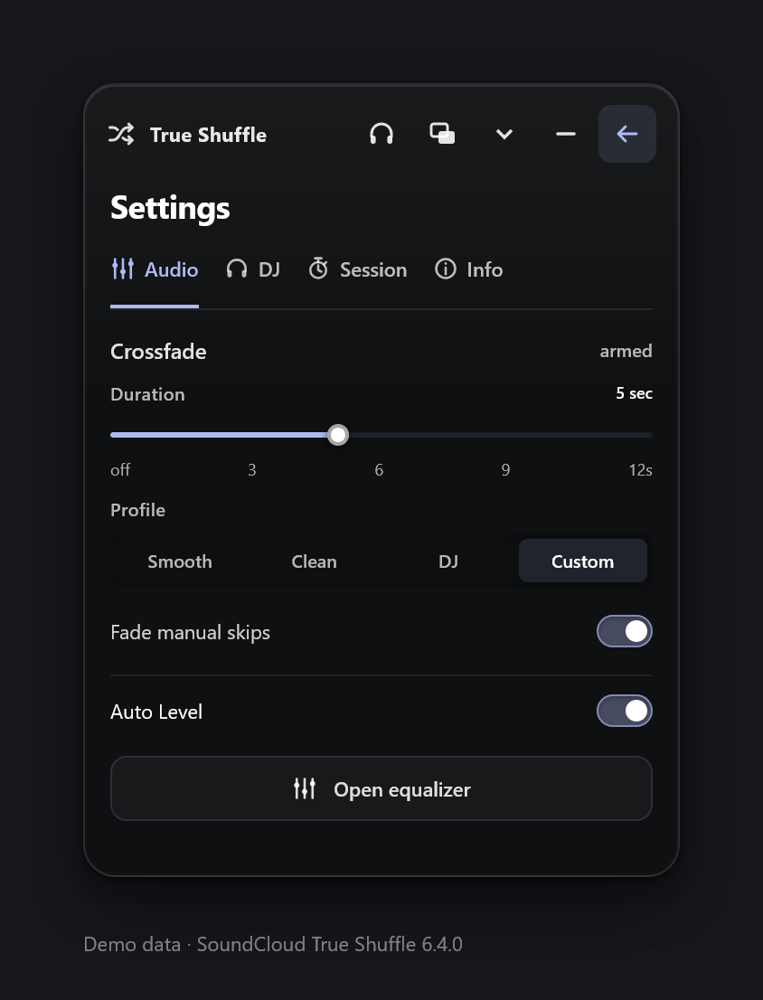
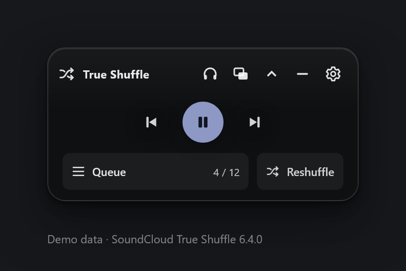
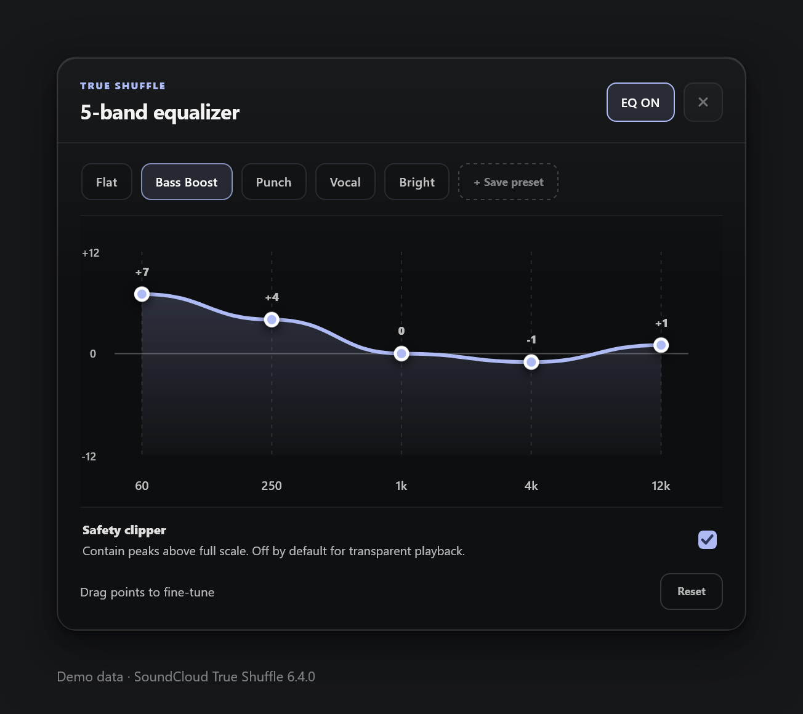
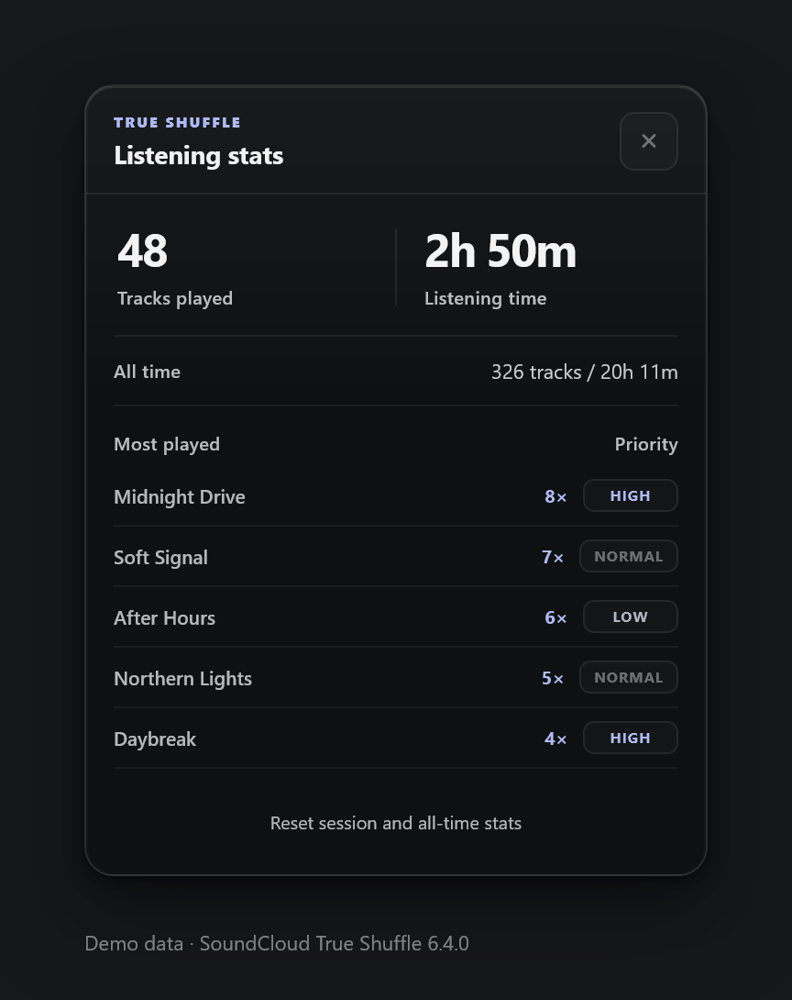

# SoundCloud True Shuffle

[](CHANGELOG.md)
[](LICENSE)
[](https://raw.githubusercontent.com/mrketa/soundcloud-true-shuffle/main/dist/SC%20Trueshuffle.user.js)

A userscript for SoundCloud with collection-wide shuffle, an optional **True DJ** mode, a floating player, an editable queue and audio controls.

**[Install from GitHub](https://raw.githubusercontent.com/mrketa/soundcloud-true-shuffle/main/dist/SC%20Trueshuffle.user.js)** · [Install from Greasy Fork](https://greasyfork.org/en/scripts/568821-soundcloud-true-shuffle) · [Release notes](CHANGELOG.md) · [Report an issue](https://github.com/mrketa/soundcloud-true-shuffle/issues)



*Version 6.4.0 interface shown with demo data, not a live SoundCloud listening session.*

## Install

1. Install [Tampermonkey](https://www.tampermonkey.net/) or [Violentmonkey](https://violentmonkey.github.io/get-it/), where available for your browser. Safari users can use Tampermonkey.
2. Open the **[canonical GitHub userscript](https://raw.githubusercontent.com/mrketa/soundcloud-true-shuffle/main/dist/SC%20Trueshuffle.user.js)** and confirm installation in your userscript manager. [Greasy Fork](https://greasyfork.org/en/scripts/568821-soundcloud-true-shuffle) is an alternative installation channel.
3. **Disable any other True Shuffle copies**, including diagnostic copies, then reload SoundCloud.

The GitHub link points to the public build on `main`. Choose one installation channel rather than enabling both copies.

## What it does

- **Collection-wide shuffle:** collects available tracks from playlists, likes, profile tracks, reposts and the Feed silently in the background (with a configurable Feed track limit) before shuffling with Fisher–Yates. New rounds continue when the current round finishes.
- **True DJ:** an optional Spotify-style DJ (header headphones icon beside PiP or **Settings → DJ**; always starts off on page load while keeping saved preferences and resets cleanly at session end for one-click restarts with zero background downloads while off). Sequences 3–4 track sets across 8 archetypes (including cross-session opener rotation and live SoundCloud `/related` discovery) with **Camelot harmonic key** & BPM flow, one-click **Switch vibe**, smart waveform auto-mixing, optional **Local Voice** (*Studio HD · Kokoro 82M* CPU WASM default with off-main-thread vocal DSP, *Studio Ultra* WebGPU, or *Low-Spec · Fast Lite*), or one-click **Silent** curation.
- **Queue control:** search, reorder upcoming tracks by drag-and-drop or by typing a target queue slot number directly (in the Queue or PiP Queue, including filtered search results), use Play Next, review listening history, and merge playlists into the session. Merged sources automatically sync new tracks, metadata/artwork/collaborator updates, and replaced audio files without reloading.
- **Floating player:** artwork, waveform, volume and playback controls, always-available shrink mode, a draggable **Hide player** pill, and picture-in-picture options where supported.
- **Audio tools:** a two-deck player, adjustable crossfade with Smooth, Clean, DJ and Custom Bézier curve profiles (with built-in and saved custom transition presets plus live transition preview), a five-band equalizer with saved custom presets, and Auto Level to reduce volume differences between tracks.
- **Session controls:** a sleep timer, Stop after this round, and an explicit End shuffle session action.
- **Playback supervision:** background scheduling, bounded stall recovery, signed stream expiry refresh, AAC-first MSE codec selection, semantic/ARIA DOM fallbacks, and automatic `AudioContext` device-switch self-healing, subject to browser and operating-system limits.
- **Update notifications:** checks once per day for a newer stable release and offers a compact Greasy Fork / GitHub release chooser in the player header.

Track availability still depends on SoundCloud, your account and network conditions. Collection loading cannot make unavailable tracks playable.

## Use it

1. Open a supported collection page on SoundCloud. Find the floating **True Shuffle** player in the lower-left corner.
2. Select **Start shuffle** and let the collection load. Use **Cancel loading** if you want to abandon it.
3. Open **Queue** to manage upcoming tracks or merge another playlist. **Reshuffle**, beside Queue, reshuffles upcoming tracks without reloading the page.
4. Open the header's **Settings** gear to adjust playback or end the session.

True Shuffle plays shuffle tracks through its own two-deck audio engine and pauses SoundCloud's native player during active shuffle playback; clicking a SoundCloud track or transport play control directly hands playback back to SoundCloud until you resume True Shuffle.

### Settings

| Tab | Controls |
| --- | --- |
| **Audio** | Crossfade duration and profile (Smooth, Clean, DJ, and Custom Bézier curve editor), Fade manual skips, Auto Level, and Open equalizer |
| **DJ** | **True DJ** toggle, **Mood** (*Auto*, *Favorites*, *Discovery*, *Throwbacks*, *Chill*, *Energy*) & **Switch vibe**, **DJ Voice** (**Silent** vs. **Local Voice** with 7 host voices, **How often** commentary frequency, `20–150%` volume and live preview), plus collapsible **Voice quality** (*Studio HD · Kokoro 82M* `~88 MB` CPU WASM default, *Studio Ultra · Kokoro 82M* WebGPU `fp32`, or *Low-Spec · Fast Lite* `~26 MB` CPU WASM) and **Mixing & discovery** (**Auto-mix transitions**, **SoundCloud discovery**, **Clean bass swap**, **Trim silent intros & outros**) sections |
| **Session** | Sleep timer, Feed track limit (1–250, default 50), Stop after this round, and End shuffle session |
| **Info** | Listening statistics, Reduce visual effects, and Scroll long titles |

**Reduce visual effects** is a manual appearance preference, not an audio-quality or hardware-detection mode. **Scroll long titles** is independent; the system's reduced-motion preference also prevents title animation. Preferences and custom crossfade and EQ presets are stored locally where browser or userscript storage is available. Blocked storage can prevent settings from surviving a reload.

<details>
<summary>More screenshots — version 6.4.0, demo data</summary>

### True DJ



### Custom crossfade curve editor



### Audio settings



### Mini-player



### Equalizer



### Listening statistics



</details>

## Browser targets and limitations

The compatibility targets are current Chrome, Edge, Brave, Opera, Firefox and Safari with a suitable userscript manager. These are targets, **not certification that every browser and manager combination has been tested**.

- Chromium browsers and Firefox can use Tampermonkey or Violentmonkey where supported; Safari can use Tampermonkey. Manager availability and injection permissions vary.
- Picture-in-picture uses a separate document window where available, otherwise video PiP or an in-page mini-player. Controls and window behavior differ between modes.
- AAC HLS and supported Widevine-encrypted streams play through the browser's media capabilities and the declared userscript dependency, hls.js.
- Background recovery cannot prevent browser tab suspension, operating-system sleep, network interruptions or SoundCloud changes from interrupting playback.
- The script integrates with SoundCloud's web interface; site changes can affect collection loading and playback.

## Privacy and feedback

Settings, queue caches, DJ taste profiles and learned audio levels use local browser/userscript storage. Playback makes requests to SoundCloud and its media services; the userscript manager also loads the declared [hls.js dependency](https://www.jsdelivr.com/package/npm/hls.js), and **Local Voice** loads the selected studio neural TTS model (*Studio HD · Kokoro 82M* `~88 MB` CPU WASM default, *Studio Ultra · Kokoro 82M* `~310 MB` WebGPU, or *Low-Spec · Fast Lite* `~26 MB` CPU WASM) inside a background Web Worker when **True DJ** is enabled (**Silent** mode and leaving **True DJ** off download nothing). The script does not automatically upload diagnostic reports or send analytics telemetry.

If playback stalls, try **Cancel loading** or **Settings → Session → End shuffle session**, then start a new session. A classified playback fault can reveal a **red exclamation mark beside the True DJ icon** in the header. Open it and choose **Copy report**; optional full technical details have a separate copy action. Copy the report before reloading.

Reports include browser/manager information and sanitized playback diagnostics. They exclude track titles, account names, page paths, stream URLs, credentials and full exception text. **Review anything you post:** GitHub issues and Greasy Fork feedback are public.

For bugs or suggestions, open a [GitHub issue](https://github.com/mrketa/soundcloud-true-shuffle/issues) or [Greasy Fork discussion](https://greasyfork.org/en/scripts/568821-soundcloud-true-shuffle/feedback). Include:

- Browser and userscript manager versions, plus the True Shuffle version.
- The page type, steps to reproduce, and expected versus actual behavior.
- A copied diagnostic report if available; a report is not required to describe a problem.

## Build

Requirements: **Python 3**.

```sh
python build.py
```

The standard build copies [`SC Trueshuffle.js`](SC%20Trueshuffle.js) **verbatim** to [`dist/SC Trueshuffle.user.js`](dist/SC%20Trueshuffle.user.js). Edit the canonical source, then regenerate the public build.

### Optional diagnostic build

```sh
python build.py --diagnostic
```

This generates `dist/SC Trueshuffle Diagnostic.user.js`, an ignored local artifact named **SoundCloud True Shuffle (Temporary Diagnostic)**. It keeps the same `@version` as `SC Trueshuffle.js` and enables verbose diagnostic tracing while keeping the header report button hidden unless a fault occurs. Install it locally only when needed, **disable every other True Shuffle copy**, and reload SoundCloud. Its distinct name does not isolate shared preferences. Disable it before returning to the stable script.

### Repository layout

| Path | Purpose |
| --- | --- |
| [`SC Trueshuffle.js`](SC%20Trueshuffle.js) | Canonical userscript source |
| [`dist/SC Trueshuffle.user.js`](dist/SC%20Trueshuffle.user.js) | Public installable build |
| [`build.py`](build.py) | Standard and diagnostic build commands |
| [`screenshots/6.4.0/`](screenshots/6.4.0/) | Interface screenshots using demo data |
| [`CHANGELOG.md`](CHANGELOG.md) | User-facing release notes |
| [`LICENSE`](LICENSE) | MIT license |

## License

[MIT](LICENSE).
