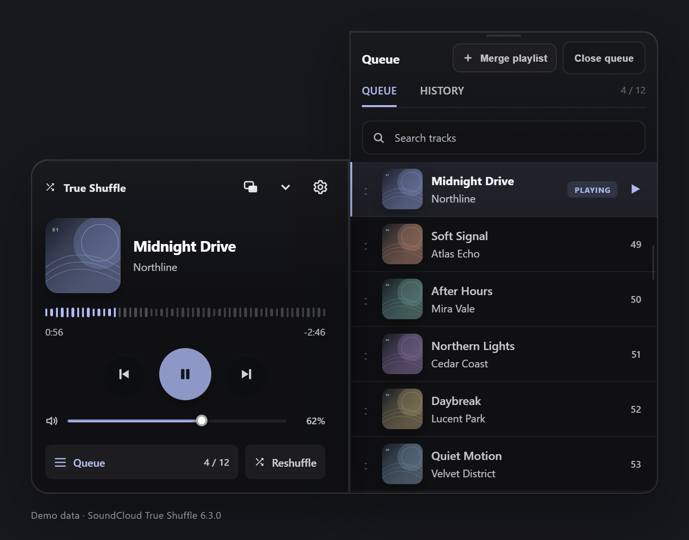
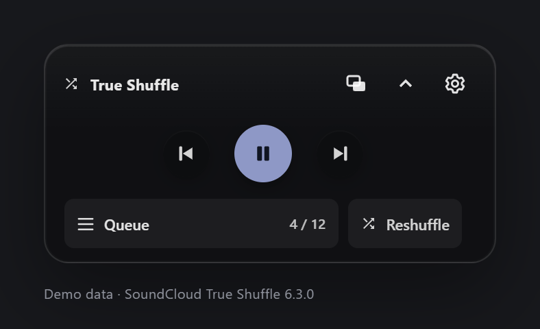
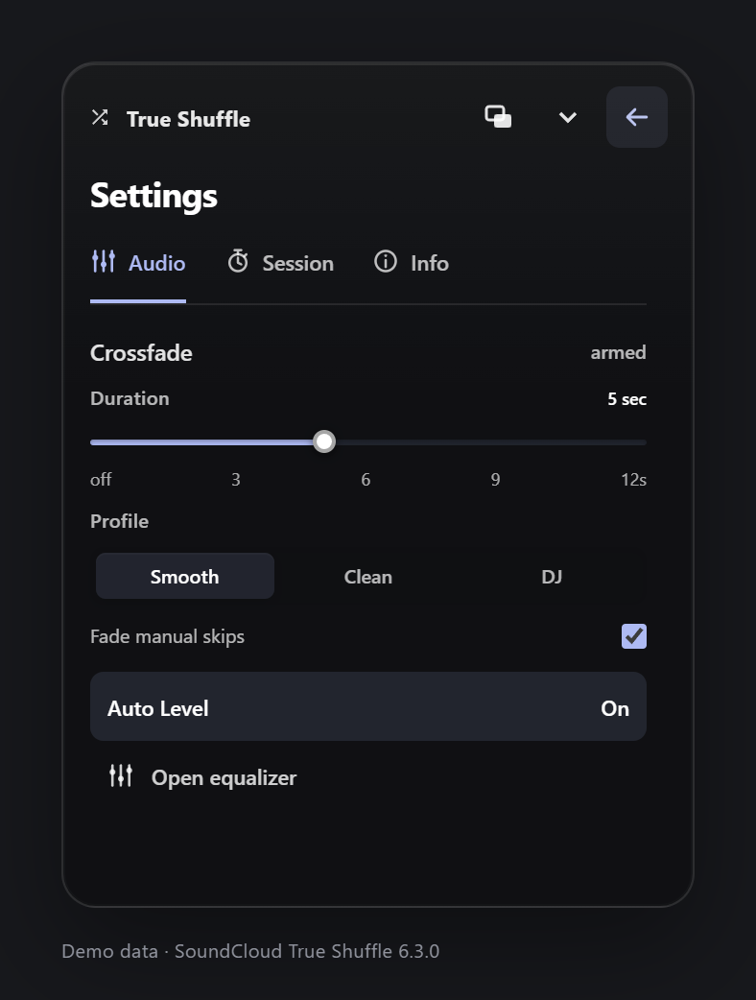
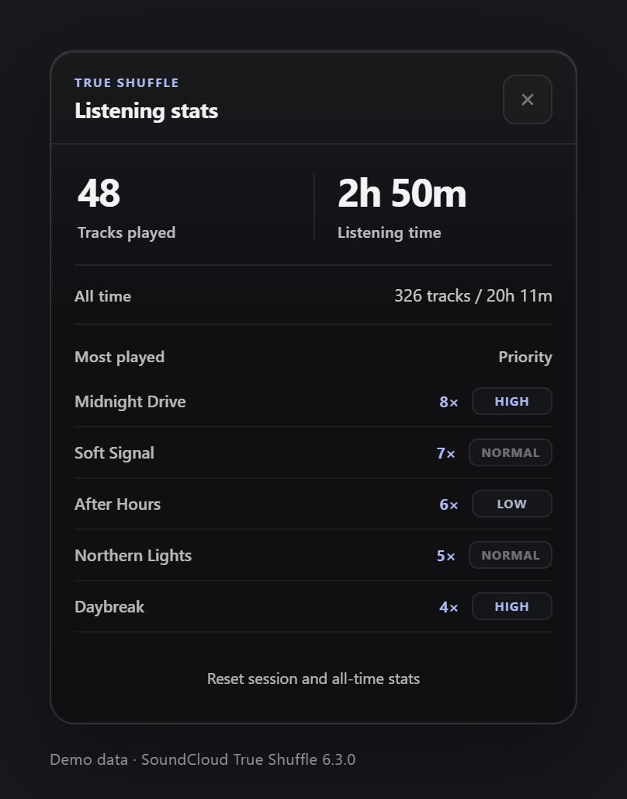
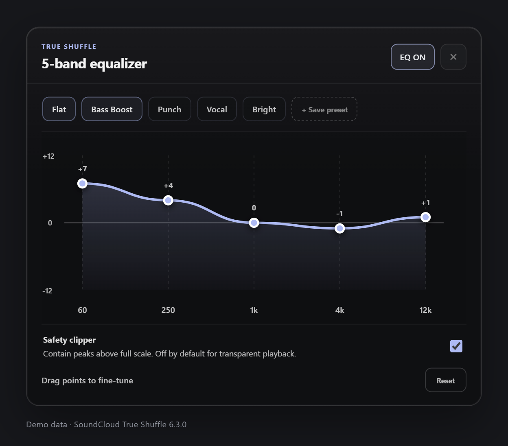

# SoundCloud True Shuffle

[](CHANGELOG.md)
[](LICENSE)
[](https://raw.githubusercontent.com/mrketa/soundcloud-true-shuffle/main/dist/SC%20Trueshuffle.user.js)

A userscript for SoundCloud with collection-wide shuffle, a floating player, an editable queue and audio controls.

**[Install from GitHub](https://raw.githubusercontent.com/mrketa/soundcloud-true-shuffle/main/dist/SC%20Trueshuffle.user.js)** · [Install from Greasy Fork](https://greasyfork.org/en/scripts/568821-soundcloud-true-shuffle) · [Release notes](CHANGELOG.md) · [Report an issue](https://github.com/mrketa/soundcloud-true-shuffle/issues)



*Version 6.3.0 interface shown with demo data, not a live SoundCloud listening session.*

## Install

1. Install [Tampermonkey](https://www.tampermonkey.net/) or [Violentmonkey](https://violentmonkey.github.io/get-it/), where available for your browser. Safari users can use Tampermonkey.
2. Open the **[canonical GitHub userscript](https://raw.githubusercontent.com/mrketa/soundcloud-true-shuffle/main/dist/SC%20Trueshuffle.user.js)** and confirm installation in your userscript manager. [Greasy Fork](https://greasyfork.org/en/scripts/568821-soundcloud-true-shuffle) is an alternative installation channel.
3. **Disable any other True Shuffle copies**, including diagnostic copies, then reload SoundCloud.

The GitHub link points to the public build on `main`. Choose one installation channel rather than enabling both copies.

## What it does

- **Collection-wide shuffle:** collects available tracks from playlists, likes, profile tracks, reposts and the Feed before shuffling with Fisher–Yates. New rounds continue when the current round finishes.
- **Queue control:** search and reorder upcoming tracks, use Play Next, review listening history, and merge playlists into the session. Merged sources are checked for new tracks.
- **Floating player:** artwork, waveform, volume and playback controls, with picture-in-picture options where supported.
- **Audio tools:** a two-deck player, adjustable crossfade with Smooth, Clean and DJ profiles, a five-band equalizer with saved custom presets, and Auto Level to reduce volume differences between tracks.
- **Session controls:** a sleep timer, Stop after this round, and an explicit End shuffle session action.
- **Playback supervision:** background scheduling and bounded stall recovery, subject to browser and operating-system limits.

Track availability still depends on SoundCloud, your account and network conditions. Collection loading cannot make unavailable tracks playable.

## Use it

1. Open a supported collection page on SoundCloud. Find the floating **True Shuffle** player in the lower-left corner.
2. Select **Start shuffle** and let the collection load. Use **Cancel loading** if you want to abandon it.
3. Open **Queue** to manage upcoming tracks or merge another playlist. **Reshuffle**, beside Queue, reshuffles upcoming tracks without reloading the page.
4. Open the header's **Settings** gear to adjust playback or end the session.

True Shuffle normally pauses SoundCloud's native player and uses its own audio decks. Certain tracks can fall back to SoundCloud's native playback; crossfade and audio processing are unavailable in that mode.

### Settings

| Tab | Controls |
| --- | --- |
| **Audio** | Crossfade duration and profile, Fade manual skips, Auto Level, and Open equalizer |
| **Session** | Sleep timer, Stop after this round, and End shuffle session |
| **Info** | Listening statistics, Reduce visual effects, and Scroll long titles |

**Reduce visual effects** is a manual appearance preference, not an audio-quality or hardware-detection mode. **Scroll long titles** is independent; the system's reduced-motion preference also prevents title animation. Preferences and custom EQ presets are stored locally where browser storage is available. Blocked storage can prevent settings from surviving a reload.

<details>
<summary>More screenshots — version 6.3.0, demo data</summary>

### Mini-player



### Settings



### Listening statistics



### Equalizer



</details>

## Browser targets and limitations

The compatibility targets are current Chrome, Edge, Brave, Opera, Firefox and Safari with a suitable userscript manager. These are targets, **not certification that every browser and manager combination has been tested**.

- Chromium browsers and Firefox can use Tampermonkey or Violentmonkey where supported; Safari can use Tampermonkey. Manager availability and injection permissions vary.
- Picture-in-picture uses a separate document window where available, otherwise video PiP or an in-page mini-player. Controls and window behavior differ between modes.
- AAC HLS playback depends on browser media capabilities and the declared userscript dependency, hls.js. Previews and HLS/MSE startup failures may use native SoundCloud playback instead.
- Background recovery cannot prevent browser tab suspension, operating-system sleep, network interruptions or SoundCloud changes from interrupting playback.
- The script integrates with SoundCloud's web interface; site changes can affect collection loading and playback.

## Privacy and feedback

Settings, queue caches and learned audio levels use local browser/userscript storage. Playback makes requests to SoundCloud and its media services; the userscript manager also loads the declared [hls.js dependency](https://www.jsdelivr.com/package/npm/hls.js). The script does not automatically upload diagnostic reports or send analytics telemetry.

If playback stalls, try **Cancel loading** or **Settings → Session → End shuffle session**, then start a new session. A classified playback fault can reveal a **red exclamation mark next to PiP** in the header. Open it and choose **Copy report**; optional full technical details have a separate copy action. Copy the report before reloading.

Reports include browser/manager information and sanitized playback diagnostics. They exclude track titles, account names, page paths, stream URLs, credentials and full exception text. **Review anything you post:** GitHub issues and Greasy Fork feedback are public.

For bugs or suggestions, open a [GitHub issue](https://github.com/mrketa/soundcloud-true-shuffle/issues) or [Greasy Fork discussion](https://greasyfork.org/en/scripts/568821-soundcloud-true-shuffle/feedback). Include:

- Browser and userscript manager versions, plus the True Shuffle version.
- The page type, steps to reproduce, and expected versus actual behavior.
- A copied diagnostic report if available; a report is not required to describe a problem.

## Development

Requirements: **Python 3** for the build and **Node.js** with the built-in `node:test` runner for regression tests.

```sh
python build.py
node --test tests/*.test.js
```

The standard build copies [`SC Trueshuffle.js`](SC%20Trueshuffle.js) **verbatim** to [`dist/SC Trueshuffle.user.js`](dist/SC%20Trueshuffle.user.js). Edit the canonical source, then regenerate the public build. The tests target that source by default; `TSS_SCRIPT` can select another script artifact explicitly. Automated tests do not replace real SoundCloud/browser integration checks.

### Optional diagnostic build

```sh
python build.py --diagnostic
```

This generates `dist/SC Trueshuffle Diagnostic.user.js`, an ignored local artifact named **SoundCloud True Shuffle (Temporary Diagnostic)**. It keeps version 6.3.0 and enables verbose diagnostic tracing. Install it locally only when needed, **disable every other True Shuffle copy**, and reload SoundCloud. Its distinct name does not isolate shared preferences. Disable it before returning to the stable script.

### Repository layout

| Path | Purpose |
| --- | --- |
| [`SC Trueshuffle.js`](SC%20Trueshuffle.js) | Canonical userscript source |
| [`dist/SC Trueshuffle.user.js`](dist/SC%20Trueshuffle.user.js) | Public installable build |
| [`build.py`](build.py) | Standard and diagnostic build commands |
| [`tests/`](tests/) | Node.js regression tests |
| [`screenshots/6.3.0/`](screenshots/6.3.0/) | Interface screenshots using demo data |
| [`CHANGELOG.md`](CHANGELOG.md) | User-facing release notes |
| [`LICENSE`](LICENSE) | MIT license |

## License

[MIT](LICENSE).
